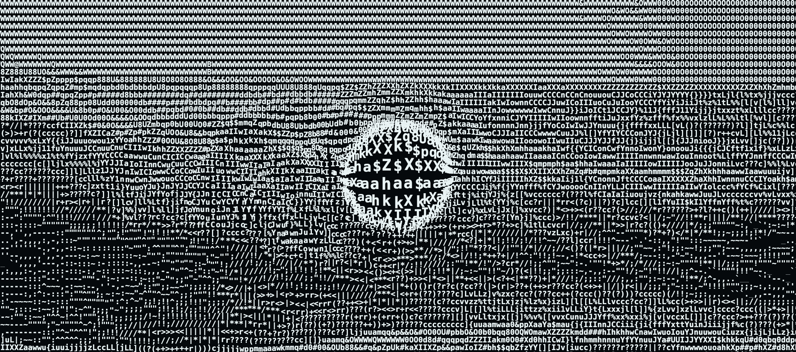

# ASCII Film

Turn a video into a moving image made of **real typographic characters**.
Encode once on your own machine; publish a tiny static website that plays the
character animation on a Canvas — no video file, no server code, no build step.


<sub>Every mark above is a glyph from DejaVu Sans Mono Bold drawn on a canvas.
100% crop:</sub>


The finished demo is in [`www/`](www/): a self-contained, looping, silent site
(2.9 MB) built from a 21-second 1080p ocean clip. Move the cursor over it and
the glyphs physically react: they part and magnify around the cursor, ripple
outward as it moves, and wag back into place when it leaves.

 Upload that folder to any
static host — see [Hosting on SiteGround](docs/SITEGROUND.md).

**Learning the technique?** The repository is tagged at every stage of the
build, from an empty skeleton to the finished site. See
[CHECKPOINTS.md](CHECKPOINTS.md) to clone any stage.

---

## How it works

```text
YOUR MACHINE (encode once)                                 ANY STATIC HOST (play)
clip.mp4 ─ ffprobe ─ ffmpeg fps+scale ─ linear-light cells ─ tone curve
      ─ glyph match (measured ink + shape) ─ temporal stabiliser
      ─ keyframes/deltas ─ zlib ─ film.ascf + manifest.json ──────▶ index.html
                                                                    player.js  ─ Canvas
                                                                    font.woff2   glyph atlas
```

1. **Calibrate the font.** Every candidate glyph is rendered with the real font
   into one character cell and its ink coverage is measured. Glyphs are sorted
   by *measured* darkness, never by ASCII order.
2. **Sample the video.** FFmpeg resamples to a constant frame rate and scales
   each frame to the character grid × an oversampling factor. Luminance is
   averaged per cell in *linear light* and re-encoded perceptually.
3. **Choose glyphs.** Each cell gets the glyph whose calibrated coverage best
   matches its tone, plus a static seeded variation so flat areas use a mix of
   similar glyphs, and optional shape matching so strokes follow edges.
4. **Stabilise in time.** A light low-pass and per-cell hysteresis stop glyphs
   flickering between neighbours; hard cuts reset the state.
5. **Pack.** Frames are stored in the documented [ASCF v1](docs/ASCF.md)
   binary: zlib keyframes plus delta frames, with an exact timestamp index.
6. **Play.** The browser decompresses frames with `DecompressionStream`, draws
   glyphs from a pre-rendered atlas at integer device pixels, and times frames
   from a wall clock (or the audio element when there is sound).
7. **Touch.** Each glyph is also a damped spring. A Gaussian bulge around the
   pointer pushes glyphs outward and scales them up (a lens made of the
   letters themselves); pointer movement launches ripple rings; underdamped
   springs make every glyph overshoot and wag home. Only 8×8-cell blocks that
   contain visibly moving glyphs are repainted, and resting glyphs are drawn
   from the same tiles as normal frames, so the picture returns pixel-exact.

## Quick start (macOS)

```bash
brew install ffmpeg python@3.13 node
git clone https://github.com/adrondak/video-ASCII-webMaker.git
cd video-ASCII-webMaker
python3.13 -m venv .venv && source .venv/bin/activate
pip install -r requirements.lock && pip install -e . --no-deps
```

Encode your own clip and preview it:

```bash
ascii-film encode my-clip.mp4 --output dist/my-film --title "My Film"
scripts/serve.sh dist/my-film          # then open http://localhost:8000/
```

Rebuild the demo site exactly as committed (put the source clip in
`assets/video/` first — source media is not part of the repo):

```bash
ascii-film encode assets/video/1080ocean.mp4 --config examples/ocean-config.json --output www --force
```

Linux works the same with your package manager's `ffmpeg`, Python ≥ 3.12 and
Node ≥ 18 (Node is only needed for tests).

## Commands

| Command | What it does |
|---|---|
| `ascii-film encode SRC -o DIR` | Build a publish directory (staged, then atomically renamed). |
| `ascii-film inspect FILE.ascf` | Validate header, glyph table, index, timestamps and every frame. |
| `ascii-film preview SRC --time 5 [--png out.png]` | Print (or rasterise) one frame — for tuning settings fast. |
| `ascii-film probe SRC` | Show what ffprobe sees: size, rotation, SAR, fps, audio. |

`ascii-film encode --help` lists every flag. Any option can also live in a JSON
config (`--config file.json`); CLI flags override the file. Paths in a config
file are relative to that file.

### Options that matter most

| Option | Default | Notes |
|---|---|---|
| `--columns` | 160 | 40–320. Rows follow from the video aspect and the font's measured cell. |
| `--fps` | 24 | 1–60. Variable-rate sources are resampled (frames may be duplicated or dropped). |
| `--font` | DejaVu Sans Mono | Must be fixed-pitch and redistributable; a `.woff2` and `LICENSE*` next to it are shipped. |
| `--line-height` | font metrics | In em. `1.0` packs rows tightly for a denser, more photographic look. |
| `--glyphs` | `" .,:;irsXA253hMHGS#9B&@"` | Up to 256 single-codepoint glyphs; order does not matter. |
| `--contrast / --gamma / --brightness` | 1 / 1 / 0 | Applied after automatic levels (`--no-auto-levels` to skip). |
| `--detail` | 0 | Shape matching strength. 0.3–0.6 sharpens edges; higher favours thin strokes. |
| `--variation` | 0.35 | Seeded per-cell texture among similar-coverage glyphs (`--seed`). |
| `--dither` | 0 | Ordered 4×4 dither between neighbouring glyphs. |
| `--stability` | 0.25 | 0–1; `--no-stabilization` to turn off. Hard cuts always reset. |
| `--loop-crossfade` | 0 | Seconds of the ending dissolved into the opening for a seamless loop. |
| `--foreground / --background` | `#eeeeee` / `#101010` | Light-on-dark keeps the source polarity; dark-on-light inverts mapping automatically. `--invert` flips it. |
| `--autoplay` | `muted` | `muted` starts on load and loops; `off` waits for a click. |
| `--audio` | off | Opt-in: package the soundtrack as AAC `audio.m4a`; it then becomes the master clock. |
| `--no-lens` / `--no-ripples` | on / on | Turn off the cursor lens or the ripples. |
| `--lens-radius` | 7 | Lens radius in cell widths. |
| `--lens-strength` | 1.4 | Push and magnification: the centre is magnified 1 + this (0–2.2). |
| `--ripple-strength` | 1 | Multiplier on how hard ripples push and swell glyphs (0–4). |

The demo's settings are in [`examples/ocean-config.json`](examples/ocean-config.json).

## The publish directory

```text
www/
  index.html  player.css  player.js  decoder.js  renderer.js  field.js  ← the player (no dependencies)
  film.ascf                                                    ← the animation
  manifest.json                                                ← grid, timing, font metrics, theme
  font.woff2  FONT-LICENSE.txt                                 ← bundled licensed webfont
  .htaccess                                                    ← optional Apache/SiteGround tuning
  audio.m4a                                                    ← only with --audio
```

All paths are relative, so the folder works at a domain root or in any
subfolder. The source video is never copied into it.

## Hosting

Any static host works: upload the **contents** of the folder.

* **SiteGround / cPanel / any Apache host** — step-by-step guide in
  [docs/SITEGROUND.md](docs/SITEGROUND.md). `scripts/package-zip.sh www`
  makes a zip you can upload and extract in Site Tools → File Manager.
* **GitHub Pages** — push the folder's contents to a `gh-pages` branch (or
  publish `www/` with a Pages workflow).
* **Netlify / Cloudflare Pages / S3** — drag-and-drop or sync the folder.

Correct MIME types help but are not required: `.js` → `text/javascript`,
`.json` → `application/json`, `.woff2` → `font/woff2`, `.ascf` →
`application/octet-stream`. The `.htaccess` sets these on Apache.

## Player controls

Controls appear on mouse movement, tap or keyboard focus and fade while
playing. Keyboard: **Space/K** play-pause · **←/→** seek 5 s (**Shift** = one
frame) · **Home** start · **L** loop · **T** colour theme · **F** fullscreen ·
**I** glyph lens/ripples on-off · **M** mute (films with audio). Click or tap
sends a shockwave through the glyphs; on touch screens, drag a finger to move
the lens. Visitors who prefer reduced motion get a paused first frame, a play
button instead of autoplay, and no glyph physics.

## Testing

```bash
scripts/make-fixture.sh                 # synthetic test videos (FFmpeg)
pytest -q                               # 84 Python unit + integration tests
npm test                                # Node decoder + glyph-physics tests
npm install && npm run e2e:install
npm run e2e                             # Playwright: Chromium, Firefox, WebKit
node scripts/profile-player.mjs www     # playback timing at 1920×1080 @2x
```

Measured results are in [docs/REPORT.md](docs/REPORT.md).

## Troubleshooting

| Symptom | Fix |
|---|---|
| `ffmpeg and ffprobe not found` | `brew install ffmpeg` (or your distro's package). |
| `output directory … is not empty` | Pass `--force` to replace it (the old folder is removed only after the new one is complete). |
| `font … is not fixed-pitch` | Use a monospaced font, or `--allow-proportional-font` if you really mean it. |
| `no license file found next to font` | Put the font's `LICENSE` beside it or pass `--font-license`. Only ship fonts you may redistribute. |
| Page says *DecompressionStream* is missing | The browser is too old; use current Chrome, Edge, Firefox or Safari (2023+). |
| Blank page when opening `index.html` from disk | Browsers block `fetch` on `file://`. Serve it: `scripts/serve.sh www`. |
| Audio won't seek in local preview | `python -m http.server` lacks HTTP Range; `scripts/serve.sh` supports it, as do real hosts. |
| HTTP 404 for `film.ascf` after upload | Upload the folder's *contents* (and the hidden `.htaccess`); check file names are unchanged. |
| Image looks too dark / flat | Try `ascii-film preview clip.mp4 --time N --png x.png` with `--gamma 0.7`, `--contrast 1.1`, or a bigger glyph set. |
| Large `film.ascf` | Fewer `--columns`, lower `--fps`, or a shorter clip. The whole file downloads before playback in v1. |

## Limitations (v1)

The whole `.ascf` downloads before playback; output is constant frame rate;
monochrome only; requires `DecompressionStream`; Firefox E2E tests could not be
run in the build environment (see the report). Future ideas: HTTP range
streaming, palette colour, GPU encoding, alternate grid sizes, subtitles.

## Licence

Code: MIT ([LICENSE](LICENSE)). Bundled DejaVu fonts: Bitstream Vera / public
domain changes ([assets/fonts/LICENSE-DejaVu.txt](assets/fonts/LICENSE-DejaVu.txt)).
The full design specification this project was built from is in
[build.md](build.md).
